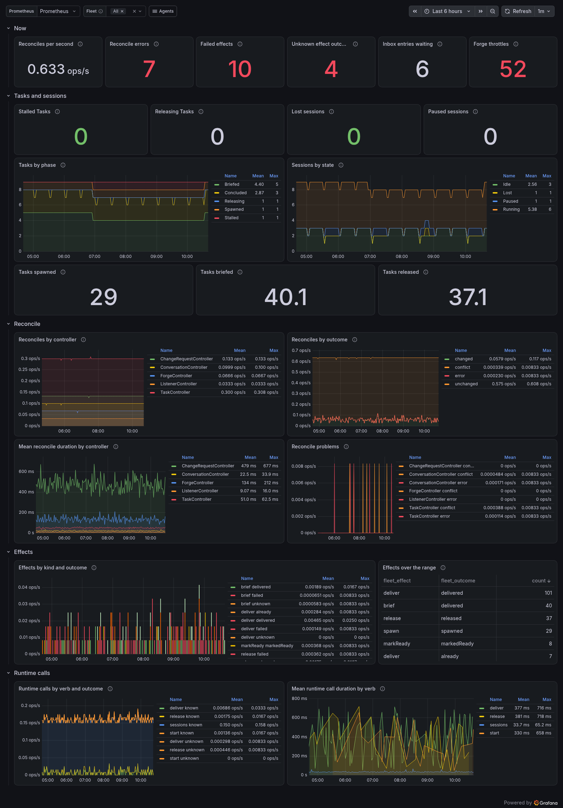

# agent-observability

Grafana dashboards, Prometheus alerts and an OpenTelemetry quick-start for
[thurbox](https://github.com/Thurbeen/thurbox) v3: Fleet, the thurbox
interface and the coding agents Fleet launches.



## Quick start

You need Docker with Compose, and [uv](https://docs.astral.sh/uv/) for the
demo data.

```sh
git clone https://github.com/Thurbeen/agent-observability && cd agent-observability
docker compose -f quickstart/compose.yaml up -d
uv run tools/synthetic.py      # optional demo data; skip it on a stack for real telemetry
```

Open <http://localhost:3000/dashboards>. The dashboards are in **Agents →
Fleet** and **Agents → Thurbox**.

Send real telemetry to the collector on `localhost:4318`, where you start
Fleet or thurbox. The programs they start inherit it, and Fleet points each
agent's own telemetry at the same collector:

```sh
export OTEL_EXPORTER_OTLP_ENDPOINT=http://localhost:4318
export OTEL_LOGS_EXPORTER=otlp   # optional: the thurbox interface's warnings
fleet up                         # or: thurbox
```

The stack listens on `127.0.0.1` only, and Grafana lets anyone on the machine
in as an admin. Stop it with `docker compose -f quickstart/compose.yaml down -v`.

## Use your own Grafana

1. Route OTLP through a collector with `deltatocumulative`, as
   [`collector/otelcol.yaml`](collector/otelcol.yaml) does, into a
   Prometheus 3 with `--web.enable-otlp-receiver`.
2. Import `dashboards/fleet/*.json` and `dashboards/thurbox/*.json` in
   *Dashboards → New → Import*, and pick your data sources in each
   dashboard's variables.
3. Add `rules/fleet.rules.yml` to Prometheus's `rule_files`.

[docs/setup.md](docs/setup.md) covers provisioning, the Prometheus settings
and Loki.

## What's included

| | Fleet | Thurbox |
| --- | --- | --- |
| Dashboards | Overview (Tasks, sessions, reconciles, effects, runtime calls), forge polling, Gateway and inbox, traces | Interface (Fleet commands and warnings), agent usage (tokens and cost of every agent, by Task) |
| Alerts | 11, in [`rules/fleet.rules.yml`](rules/fleet.rules.yml) | None: the interface exports no metrics |
| Signals | Metrics and spans, from `fleet`, `runtime-mux` and `workspace-git` | Spans and log records, plus Claude Code's and Codex's usage metrics |
| Details | [docs/fleet.md](docs/fleet.md) | [docs/thurbox.md](docs/thurbox.md) |

Every alert has a section in the [runbook](docs/runbook.md). More screenshots
are in [docs/screenshots](docs/screenshots).

## Compatibility

| Product | Supported | Catalog pinned to |
| --- | --- | --- |
| thurbox and Fleet | v3, from the thurbox monorepo. Fleet 2.x and thurbox 2.x are not supported. | [`facebe5`](catalog/thurbox.json) on `main`, until v3.0.0 is tagged |
| Codex | Token usage from `codex.turn.token_usage`. Seen working on 0.161 to 0.165. | [rust-v0.166.0](catalog/codex.json) |
| Claude Code | Tokens and cost from `claude_code.token.usage` and `claude_code.cost.usage`. Seen working on 2.1.304 to 2.1.312. | [documentation](catalog/claude-code.json) |

CI derives each catalog from the product's source at the pinned ref, or for Claude Code from its documentation. A
dashboard or rule that names anything else fails the build.
[docs/development.md](docs/development.md) explains how to move to a new tag.

## License

[MIT](LICENSE)
