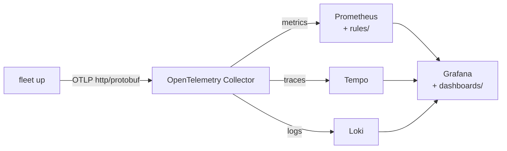

# fleet-monitoring

Grafana dashboards, Prometheus rules and an OpenTelemetry Collector
quick-start for [Fleet](https://github.com/Thurbeen/fleet) v2.

Fleet exports traces and metrics over OTLP when the standard `OTEL_*`
variables name a collector. This repository turns that telemetry into
dashboards and alerts. Every query names only what Fleet exports, and CI
checks this against Fleet's source at a pinned tag.



## Contents

| Path | What it holds |
| --- | --- |
| `dashboards/` | Four Grafana dashboards: **Fleet overview**, **Fleet forge polling**, **Fleet Gateway and inbox** and **Fleet traces**. |
| `rules/fleet.rules.yml` | Prometheus recording rules and alerts. `rules/tests/` holds their unit tests. |
| `docs/runbook.md` | One section for each alert. Each alert links to its section. |
| `collector/otelcol.yaml` | An OpenTelemetry Collector config that receives Fleet's OTLP and sends it to Prometheus, Tempo and Loki. |
| `quickstart/` | A Docker Compose stack: the collector, Prometheus, Tempo, Loki and Grafana. |
| `catalog/fleet.json` | The metrics, labels and spans Fleet exports at the pinned tag. |
| `tools/`, `tests/` | The dashboard generator, the catalog, the lint and the smoke test. |

## Quick start

You need Docker with Compose, and Fleet v2.4.0 or later.

1. Start the stack:

   ```sh
   docker compose -f quickstart/compose.yaml up -d
   ```

2. Point Fleet at the collector where `fleet up` runs:

   ```sh
   OTEL_EXPORTER_OTLP_ENDPOINT=http://localhost:4318 fleet up
   ```

3. Open <http://localhost:3000/dashboards/f/fleet>. The first points arrive
   about a minute after `fleet up` starts.

The stack binds every port to `127.0.0.1`. Grafana lets anyone on the machine
in as an admin, so do not expose it. When a port is taken, set
`COLLECTOR_PORT`, `PROMETHEUS_PORT`, `TEMPO_PORT`, `LOKI_PORT` or
`GRAFANA_PORT`. Stop the stack with
`docker compose -f quickstart/compose.yaml down -v`.

## Send Fleet's telemetry

Fleet reads only the standard variables. See Fleet's
[telemetry interface](https://github.com/Thurbeen/fleet/blob/main/docs/configuration/telemetry.md).

- Fleet speaks OTLP over HTTP with protobuf only, and has no TLS client.
  Send it to a collector on `http://` that you trust, and let the collector
  forward to remote backends.
- Fleet exports metrics every 60 seconds by default
  (`OTEL_METRIC_EXPORT_INTERVAL`). No dashboard panel looks at less than two
  minutes, so a rate always has two points.
- `OTEL_SERVICE_NAME` sets `service.name`. The default is `fleet`. Set
  `service.namespace` in `OTEL_RESOURCE_ATTRIBUTES` to tell several managers
  apart.

## Use an existing Grafana and Prometheus

### Metrics in Prometheus

The dashboards and rules expect Prometheus's OTLP naming:
`fleet_reconcile_duration_seconds_*`, `fleet_effects_total`,
`fleet_forge_calls_total` and `fleet_inbox_depth`. Two setups produce it:

- **Prometheus 3 OTLP receiver.** Start Prometheus with
  `--web.enable-otlp-receiver`. Send to `/api/v1/otlp` from the collector, as
  `collector/otelcol.yaml` does. Prometheus sets `job` to
  `service.namespace/service.name`.
- **Collector `prometheus` exporter, scraped by Prometheus.** This exporter is
  in the collector-contrib distribution. Without `honor_labels: true` on the
  scrape job, `job` is the scrape job's name. The dashboards still work, but
  one `job` then covers every manager behind that collector.

Every dashboard has a **Fleet** variable over `job`, so one Grafana shows
several managers.

### Dashboards

Each dashboard selects its data sources through template variables:
`prometheus`, and `tempo` for **Fleet traces**. Each has a fixed `uid` and no
numeric `id`. Load them in one of two ways:

- **Import:** in Grafana, open *Dashboards → New → Import* and upload a file
  from `dashboards/`. Then pick the data source in the dashboard's variable.
- **Provisioning:** copy `dashboards/*.json` to a directory that a file
  provider reads, as `quickstart/grafana/provisioning/dashboards/fleet.yaml`
  does.

**Fleet traces** needs TraceQL metrics for its two latency panels. Tempo 3
serves them with the quick-start's plain configuration.

### Rules

Add `rules/fleet.rules.yml` to `rule_files` in Prometheus, or load it into
your ruler. Each alert has a `severity` label: `critical`, `warning` or
`info`. Route on it in Alertmanager.

| Alert | Severity | Condition |
| --- | --- | --- |
| `FleetNotReconciling` | critical | A manager reconciled nothing for 10 minutes, or its metrics stopped. |
| `FleetReconcileErrors` | warning | More than 5% of reconciles ended in error for 15 minutes. |
| `FleetLeaseLost` | warning | A reconcile lost the manager lease. |
| `FleetEffectsFailing` | warning | An effect failed in the last 15 minutes. |
| `FleetEffectOutcomesUnknown` | warning | Three or more effect outcomes were unknown in 30 minutes. |
| `FleetForgeThrottled` | warning | A forge throttled change polls for about 30 minutes. |
| `FleetForgeNotLoggedIn` | critical | Change polls fail on the forge login or permissions. |
| `FleetForgeUnanswered` | warning | More than half of the polls to a host got no answer for 15 minutes. |
| `FleetInboxBacklog` | info | Inbox entries waited for about an hour. |

## Compatibility

| Fleet | This repository |
| --- | --- |
| v2.4.0 and later | Supported. The catalog is pinned to v2.4.0. |
| v2.0 – v2.3 | Not supported. These releases have no OTLP export. |
| v1 | Not supported. Fleet v1 exported different `factory_*` metrics. |

A later Fleet release can rename or add telemetry. To move to a new tag:

1. Run `uv run tools/catalog.py --write --tag vX.Y.Z`.
2. Run `uv run tools/lint.py`. It lists every query that names something the
   new release does not export.

## What Fleet does not export yet

- **Tasks by phase.** No gauge counts Tasks per phase. No panel or alert can
  show Releasing or NeedsAttention Tasks. The overview's **Task flow** row
  counts the spawn, brief and release effects instead.
- **Inbox depth per Task.** `fleet.inbox.depth` is one total without a Task
  attribute. The **Fleet traces** dashboard finds the Task through its
  `effect deliver` spans.
- **Reconcile quantiles from buckets.** Fleet v2.4 records
  `fleet.reconcile.duration` in seconds on the SDK's default bucket bounds,
  which are millisecond-scale. Almost every point lands in the first bucket,
  so `histogram_quantile()` gives wrong answers. The dashboards show the mean
  from `_sum / _count`, and p50/p95 from spans in Tempo.
- **Logs.** Fleet exports no logs over OTLP. The collector's logs pipeline
  serves other producers.

## Development

The tools need [uv](https://docs.astral.sh/uv/) only. Each script declares its
own dependencies.

```sh
uv run tools/dashboards.py --write   # regenerate dashboards/ after editing the generator
uv run tools/lint.py                 # check dashboards and rules against the catalog
uv run tools/catalog.py              # check the catalog against Fleet's source
uv run tests/test_lint.py            # lint unit tests
uv run tests/smoke.py                # against a running quick-start stack
prek install                         # run the local checks on every commit
```

Edit `tools/dashboards.py`, not the JSON. CI fails when `dashboards/` differs
from the generator's output.

## License

[MIT](LICENSE)
