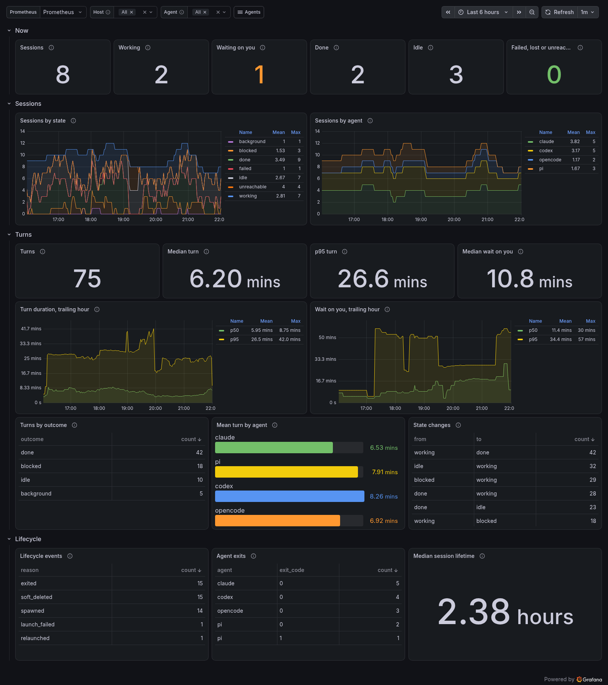

# agent-observability

Grafana dashboards, Prometheus alerts and an OpenTelemetry quick-start for
[Fleet](https://github.com/Thurbeen/fleet) and
[Thurbox](https://github.com/Thurbeen/thurbox).



## Quick start

You need Docker with Compose, and [uv](https://docs.astral.sh/uv/) for the
demo data.

```sh
git clone https://github.com/Thurbeen/agent-observability && cd agent-observability
docker compose -f quickstart/compose.yaml up -d
uv run tools/synthetic.py      # optional demo data; skip it on a stack for real telemetry
```

Open <http://localhost:3000/dashboards>. The dashboards are in **Agents →
Fleet** and **Agents → Thurbox**.

Send real telemetry to the collector on `localhost:4318`:

- **Fleet:** `OTEL_EXPORTER_OTLP_ENDPOINT=http://localhost:4318 fleet up`
- **Thurbox:** set `enabled = true` under `[telemetry]` in `settings.toml`.

The stack listens on `127.0.0.1` only, and Grafana lets anyone on the machine
in as an admin. Stop it with `docker compose -f quickstart/compose.yaml down -v`.

## Use your own Grafana

1. Route OTLP through a collector with `deltatocumulative`, as
   [`collector/otelcol.yaml`](collector/otelcol.yaml) does, into a
   Prometheus 3 with `--web.enable-otlp-receiver`.
2. Import `dashboards/fleet/*.json` and `dashboards/thurbox/*.json` in
   *Dashboards → New → Import*, and pick your data sources in each
   dashboard's variables.
3. Add `rules/*.rules.yml` to Prometheus's `rule_files`.

[docs/setup.md](docs/setup.md) covers provisioning, the Prometheus settings
and Loki.

## What's included

| | Fleet | Thurbox |
| --- | --- | --- |
| Dashboards | Overview, forge polling, Gateway and inbox, traces | Sessions, session events, agent usage (tokens and cost of every agent) |
| Alerts | 9, in [`rules/fleet.rules.yml`](rules/fleet.rules.yml) | 4, in [`rules/thurbox.rules.yml`](rules/thurbox.rules.yml) |
| Signals | Metrics and spans | Metrics and log records, plus Claude Code's and Codex's usage metrics |
| Details | [docs/fleet.md](docs/fleet.md) | [docs/thurbox.md](docs/thurbox.md) |

Every alert has a section in the [runbook](docs/runbook.md). More screenshots
are in [docs/screenshots](docs/screenshots).

## Compatibility

| Product | Supported | Catalog pinned to |
| --- | --- | --- |
| Fleet | v2.4.0 and later. Fleet v1's `factory_*` metrics are not supported. | [v2.4.0](catalog/fleet.json) |
| Thurbox | v2.77.0 and later, with `[telemetry]` on. v2.62 to v2.76 work without the `failed` state, so **ThurboxLaunchFailed** never fires there. | [v2.77.0](catalog/thurbox.json) |
| Codex | Token usage from `codex.turn.token_usage`. Seen working on 0.161 to 0.165. | [rust-v0.166.0](catalog/codex.json) |
| Claude Code | Tokens and cost from `claude_code.token.usage` and `claude_code.cost.usage`. Seen working on 2.1.304 to 2.1.312. | [documentation](catalog/claude-code.json) |

CI derives each catalog from the product's source at the pinned tag, or for Claude Code from its documentation. A
dashboard or rule that names anything else fails the build.
[docs/development.md](docs/development.md) explains how to move to a new tag.

## License

[MIT](LICENSE)
