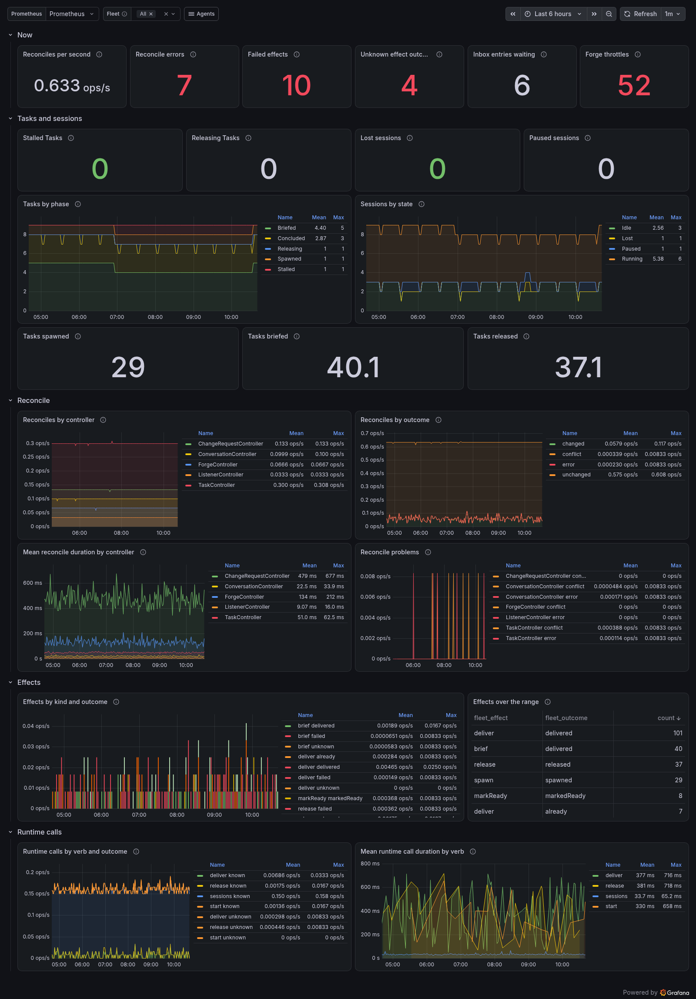
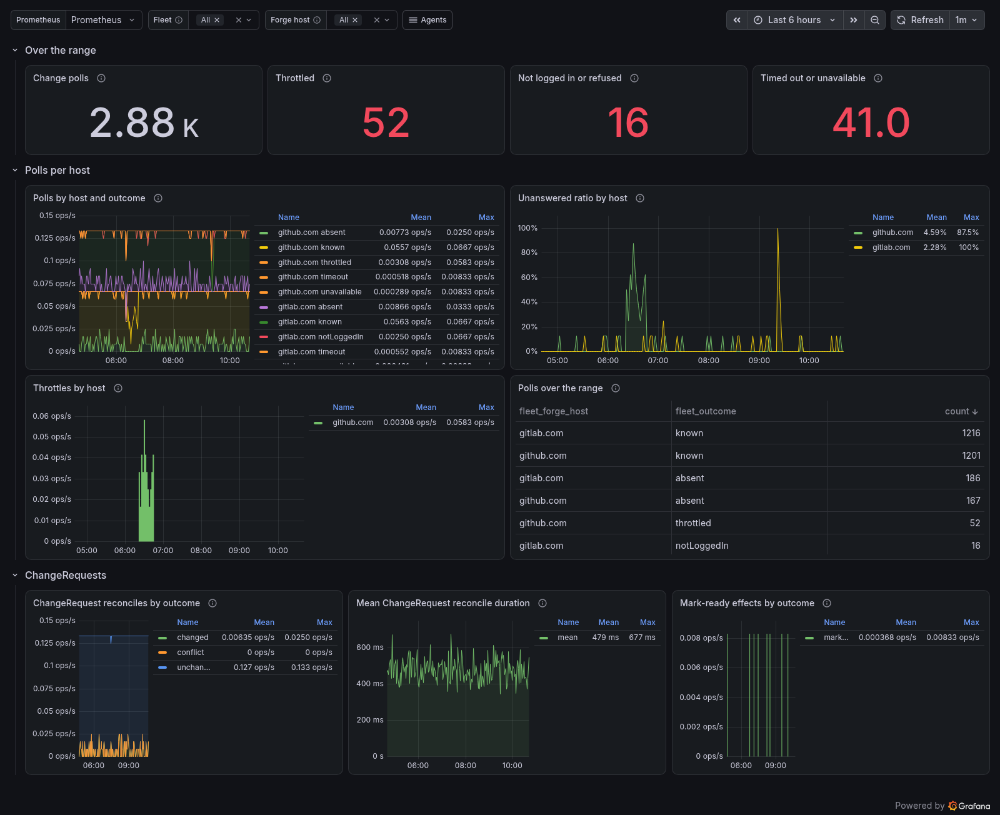
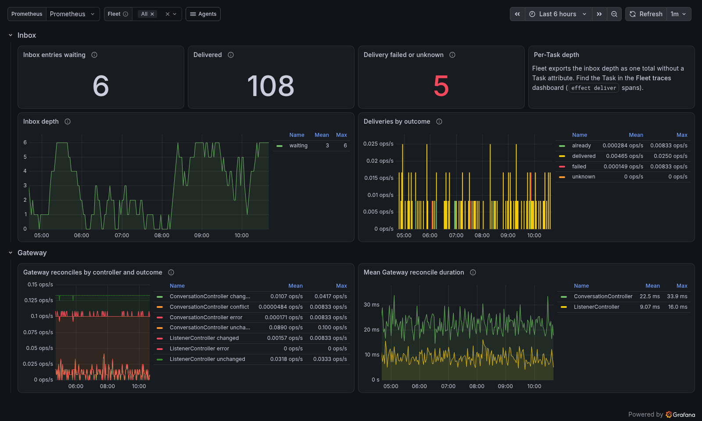
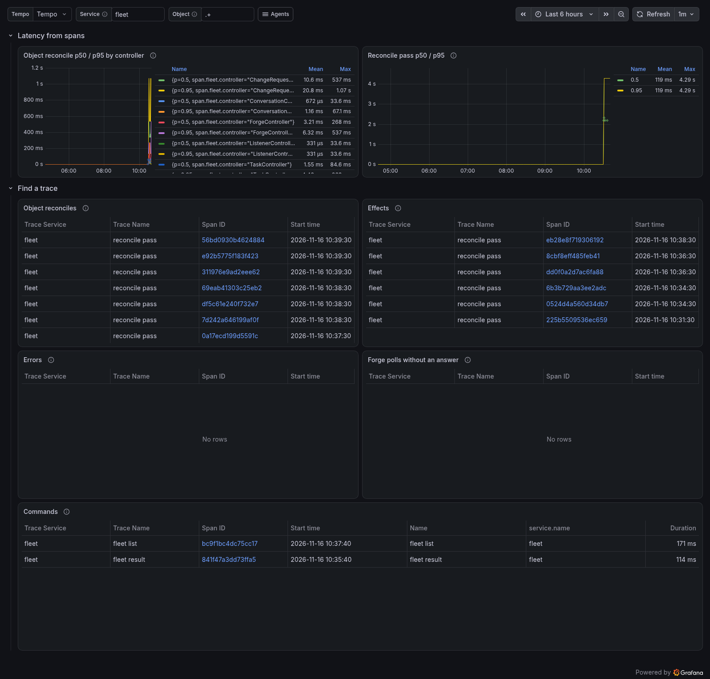

# Fleet

Fleet ships in the thurbox v3 monorepo. It exports traces and metrics over
OTLP when the standard `OTEL_*` variables name a collector, and so do the
`runtime-mux` and `workspace-git` programs it runs. See thurbox's
[observability interface](https://github.com/Thurbeen/thurbox/blob/main/docs/observability.md).



## Send Fleet's telemetry

```sh
OTEL_EXPORTER_OTLP_ENDPOINT=http://localhost:4318 fleet up
```

- Fleet speaks OTLP over HTTP with protobuf only, and has no TLS client.
- Fleet exports metrics every 60 seconds by default
  (`OTEL_METRIC_EXPORT_INTERVAL`). No dashboard panel looks at less than two
  minutes, so a rate always has two points.
- `OTEL_SERVICE_NAME` sets `service.name`. The default is `fleet`. Set
  `service.namespace` in `OTEL_RESOURCE_ATTRIBUTES` to tell several managers
  apart. Every Fleet dashboard has a **Fleet** variable over `job`.
- Each agent Fleet launches exports its own telemetry to the same collector,
  tagged with `fleet.task` and `fleet.uid`. The **Agent usage** dashboard
  reads it ([docs/thurbox.md](thurbox.md#agent-usage)).

## Dashboards

| Dashboard | Shows |
| --- | --- |
| **Fleet overview** | Tasks by phase, sessions by state, reconciles, errors, effects and runtime calls. |
| **Fleet forge polling** | ChangeRequest polls per forge host: answers, throttles and failures. |
| **Fleet Gateway and inbox** | Inbox depth, deliveries and the Gateway controllers. |
| **Fleet traces** | Reconcile p50/p95 from spans, runtime call p50/p95 as Fleet, `runtime-mux` and `workspace-git` see them, and trace search by object, effect and error. |

| | |
| --- | --- |
|  |  |
|  | |

## Alerts

| Alert | Severity | Condition |
| --- | --- | --- |
| `FleetNotReconciling` | critical | A manager reconciled nothing for 10 minutes, or its metrics stopped. |
| `FleetReconcileErrors` | warning | More than 5% of reconciles ended in error for 15 minutes. |
| `FleetLeaseLost` | warning | A reconcile lost the manager lease. |
| `FleetEffectsFailing` | warning | An effect failed in the last 15 minutes. |
| `FleetEffectOutcomesUnknown` | warning | Three or more effect outcomes were unknown in 30 minutes. |
| `FleetForgeThrottled` | warning | A forge throttled change polls for about 30 minutes. |
| `FleetForgeNotLoggedIn` | critical | Change polls fail on the forge login or permissions. |
| `FleetForgeUnanswered` | warning | More than half of the polls to a host got no answer for 15 minutes. |
| `FleetInboxBacklog` | info | Inbox entries waited for about an hour. |
| `FleetSessionsLost` | warning | A Task's session has been `Lost` for 5 minutes. |
| `FleetTasksStalled` | warning | A Task has been `Stalled` for 5 minutes. |

## What Fleet does not export yet

- **Inbox depth per Task.** `fleet.inbox.depth` is one total without a Task
  attribute. The **Fleet traces** dashboard finds the Task through its
  `effect deliver` spans.
- **Reconcile quantiles from buckets.** Fleet records
  `fleet.reconcile.duration` and `fleet.runtime.call.duration` in seconds on
  the SDK's default bucket bounds, which are millisecond-scale. Almost every
  point lands in the first bucket, so `histogram_quantile()` gives wrong
  answers. The dashboards show the mean from `_sum / _count`, and p50/p95
  from spans in Tempo.
- **Logs.** Fleet exports no logs over OTLP.
