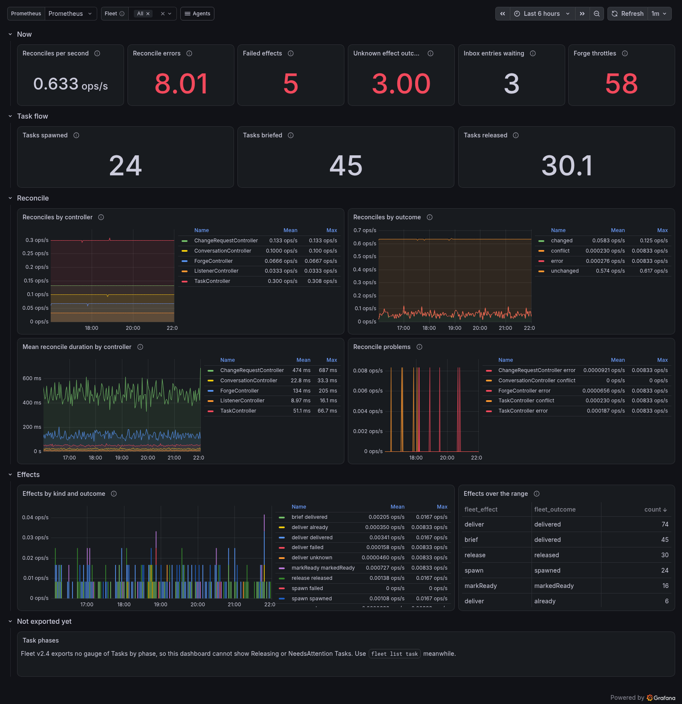
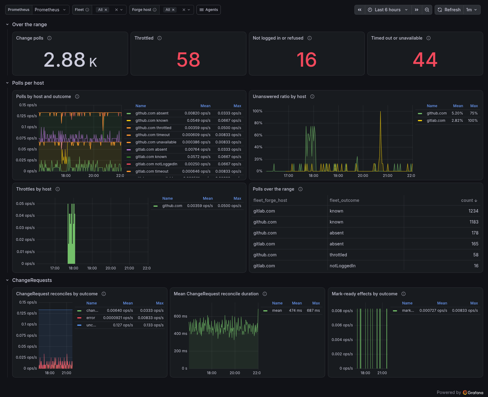
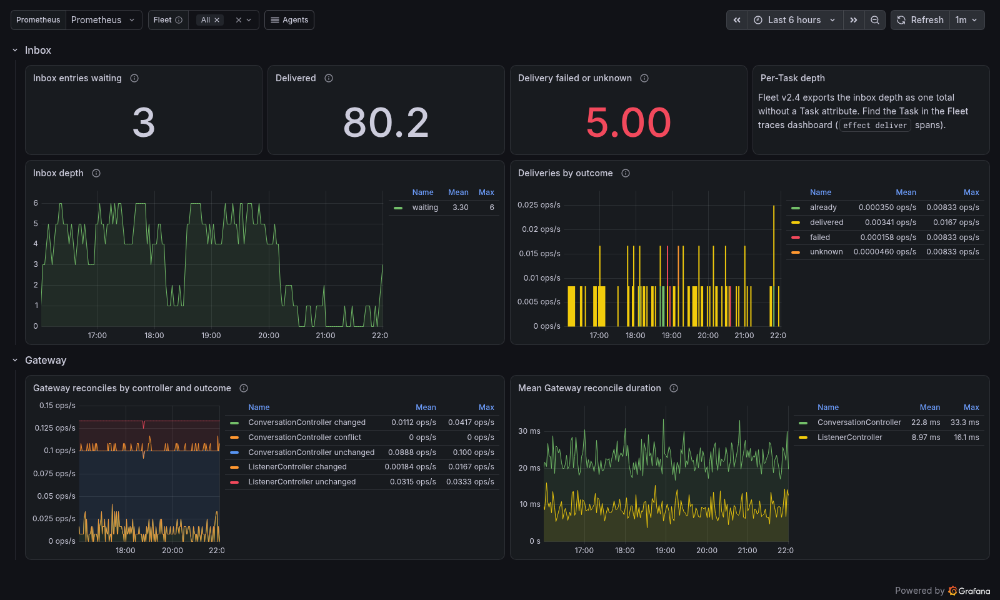
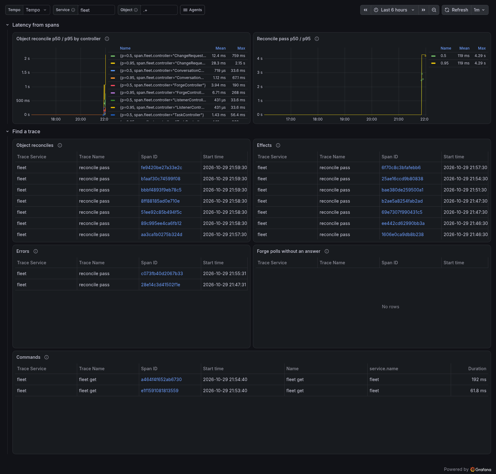

# Fleet

Fleet v2 exports traces and metrics over OTLP when the standard `OTEL_*`
variables name a collector. See Fleet's
[telemetry interface](https://github.com/Thurbeen/fleet/blob/main/docs/configuration/telemetry.md).



## Send Fleet's telemetry

```sh
OTEL_EXPORTER_OTLP_ENDPOINT=http://localhost:4318 fleet up
```

- Fleet speaks OTLP over HTTP with protobuf only, and has no TLS client.
- Fleet exports metrics every 60 seconds by default
  (`OTEL_METRIC_EXPORT_INTERVAL`). No dashboard panel looks at less than two
  minutes, so a rate always has two points.
- `OTEL_SERVICE_NAME` sets `service.name`. The default is `fleet`. Set
  `service.namespace` in `OTEL_RESOURCE_ATTRIBUTES` to tell several managers
  apart. Every Fleet dashboard has a **Fleet** variable over `job`.

## Dashboards

| Dashboard | Shows |
| --- | --- |
| **Fleet overview** | Reconciles, errors, effects and the Task flow (spawn, brief, release). |
| **Fleet forge polling** | ChangeRequest polls per forge host: answers, throttles and failures. |
| **Fleet Gateway and inbox** | Inbox depth, deliveries and the Gateway controllers. |
| **Fleet traces** | Reconcile p50/p95 from spans, and trace search by object, effect and error. |

| | |
| --- | --- |
|  |  |
|  | |

## Alerts

| Alert | Severity | Condition |
| --- | --- | --- |
| `FleetNotReconciling` | critical | A manager reconciled nothing for 10 minutes, or its metrics stopped. |
| `FleetReconcileErrors` | warning | More than 5% of reconciles ended in error for 15 minutes. |
| `FleetLeaseLost` | warning | A reconcile lost the manager lease. |
| `FleetEffectsFailing` | warning | An effect failed in the last 15 minutes. |
| `FleetEffectOutcomesUnknown` | warning | Three or more effect outcomes were unknown in 30 minutes. |
| `FleetForgeThrottled` | warning | A forge throttled change polls for about 30 minutes. |
| `FleetForgeNotLoggedIn` | critical | Change polls fail on the forge login or permissions. |
| `FleetForgeUnanswered` | warning | More than half of the polls to a host got no answer for 15 minutes. |
| `FleetInboxBacklog` | info | Inbox entries waited for about an hour. |

## What Fleet does not export yet

- **Tasks by phase.** No gauge counts Tasks per phase. No panel or alert can
  show Releasing or NeedsAttention Tasks. The overview's **Task flow** row
  counts the spawn, brief and release effects instead.
- **Inbox depth per Task.** `fleet.inbox.depth` is one total without a Task
  attribute. The **Fleet traces** dashboard finds the Task through its
  `effect deliver` spans.
- **Reconcile quantiles from buckets.** Fleet v2.4 records
  `fleet.reconcile.duration` in seconds on the SDK's default bucket bounds,
  which are millisecond-scale. Almost every point lands in the first bucket,
  so `histogram_quantile()` gives wrong answers. The dashboards show the mean
  from `_sum / _count`, and p50/p95 from spans in Tempo.
- **Logs.** Fleet exports no logs over OTLP.
