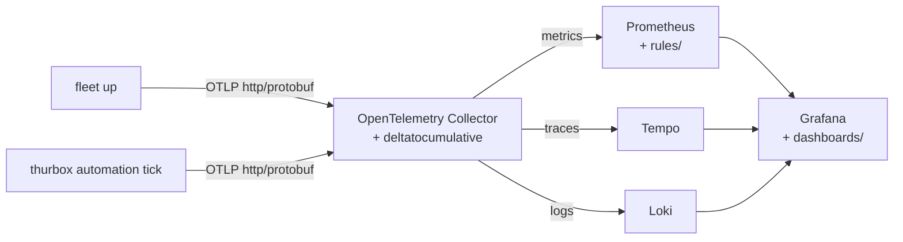

# Use an existing Grafana, Prometheus and collector

The quick-start in `quickstart/` wires everything below. This page is for an
existing stack.



## Collector

[`collector/otelcol.yaml`](../collector/otelcol.yaml) receives OTLP over
HTTP on port 4318 and sends metrics to Prometheus, traces to Tempo and logs
to Loki. It needs the contrib distribution (`otelcol-contrib`) for the
`deltatocumulative` processor: Thurbox exports its metrics as deltas, and
Prometheus stores cumulative series. Fleet's metrics are cumulative and pass
through unchanged.

Fleet and Thurbox speak OTLP over HTTP with protobuf only, and have no TLS
client. Run the collector where they reach it over `http://`, and let it
forward to remote backends.

## Prometheus

The dashboards and rules expect Prometheus's OTLP naming, such as
`fleet_effects_total` and `thurbox_turn_duration_seconds_bucket`. Two setups
produce it:

- **Prometheus 3 OTLP receiver.** Start Prometheus with
  `--web.enable-otlp-receiver`, and send to `/api/v1/otlp` from the
  collector. Prometheus sets `job` to `service.namespace/service.name`.
- **Collector `prometheus` exporter, scraped by Prometheus.** Without
  `honor_labels: true` on the scrape job, `job` is the scrape job's name. The
  Fleet dashboards still work, but one `job` then covers every manager behind
  that collector. The Thurbox dashboards and rules expect `job="thurbox"`, so
  set `honor_labels: true`.

Promote these resource attributes to labels, as
[`quickstart/prometheus.yml`](../quickstart/prometheus.yml) does:

```yaml
otlp:
  promote_resource_attributes:
    - service.version
    - host.name          # the Thurbox dashboards' Host variable
    - thurbox.instance   # tells a Thurbox sandbox from the real instance
    - thurbox.agent      # these three group the agents' own usage
    - thurbox.session.id
    - thurbox.session.name
```

Without `host.name`, two Thurbox machines write the same series. Allow
out-of-order samples (`storage.tsdb.out_of_order_time_window`), because OTLP
pushes can arrive out of order.

Add `rules/fleet.rules.yml` and `rules/thurbox.rules.yml` to `rule_files`,
or load them into your ruler. Each alert has a `severity` label: `critical`,
`warning` or `info`. Route on it in Alertmanager.

## Tempo and Loki

- **Tempo** stores Fleet's spans. **Fleet traces** needs TraceQL metrics for
  its two latency panels. Tempo 3 serves them with the quick-start's plain
  configuration.
- **Loki** stores Thurbox's session event logs and diagnostic logs. It must
  accept OTLP (`/otlp/v1/logs`, on by default in Loki 3), which turns
  `service.name` into the `service_name` stream label and each log attribute
  into structured metadata.

## Dashboards

Each dashboard picks its data sources through template variables
(`prometheus`, `tempo`, `loki`), has a fixed `uid` and no numeric `id`, and
carries the tag `agent-observability`. Load them in one of two ways:

- **Import:** open *Dashboards → New → Import*, upload a file from
  `dashboards/fleet/` or `dashboards/thurbox/`, and pick the data source in
  the dashboard's variable.
- **Provisioning:** copy the two directories to
  `<path>/Agents/Fleet` and `<path>/Agents/Thurbox`, and point a file
  provider at `<path>` with `foldersFromFilesStructure: true`, as
  [`agents.yaml`](../quickstart/grafana/provisioning/dashboards/agents.yaml)
  does. Grafana then files them under an **Agents** folder with **Fleet**
  and **Thurbox** inside.

Grafana's provider options `folder` and `folderUid` create top-level folders
only: `folder: Agents/Fleet` makes one folder with that literal title. If you
prefer fixed folder uids over nesting, use one provider per product instead:

```yaml
providers:
  - {name: fleet, type: file, folder: Fleet, folderUid: agents-fleet,
     options: {path: /var/lib/grafana/dashboards/fleet}}
  - {name: thurbox, type: file, folder: Thurbox, folderUid: agents-thurbox,
     options: {path: /var/lib/grafana/dashboards/thurbox}}
```
