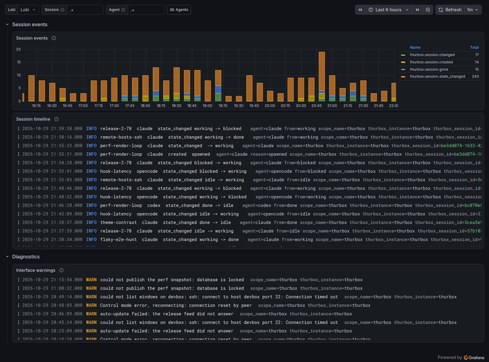
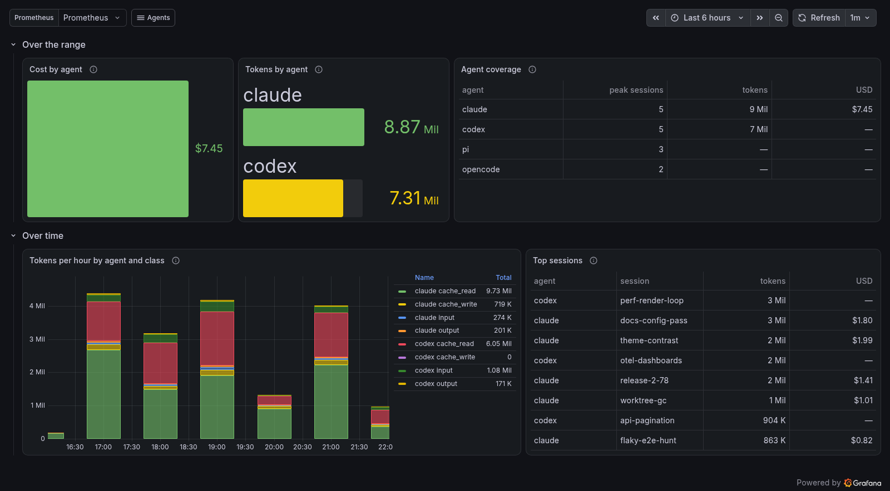

# Thurbox

Thurbox exports its own session metrics and one log record per session
event from `automation tick`, once a minute while sessions exist (Thurbox's
ADR-37). See Thurbox's
[telemetry settings](https://github.com/Thurbeen/thurbox/blob/main/docs/CONFIG.md#telemetry--opentelemetry-for-sessions).


## Send Thurbox's telemetry

In `settings.toml`:

```toml
[telemetry]
enabled = true
endpoint = "http://localhost:4318"
export_diagnostic_logs = true   # optional: the interface's WARN and ERROR lines
```

- Thurbox speaks OTLP over HTTP with protobuf only, and has no TLS client.
- The same table points each agent's own OpenTelemetry exporter at the
  collector (ADR-36), with `thurbox.agent`, `thurbox.session.id` and
  `thurbox.session.name` added to its resource. **Agent usage** reads it.
- `per_session = true` adds `thurbox.session.id` to every metric. The
  dashboards and rules sum it away.

## Signals

| Metric | Prometheus series | Labels |
| --- | --- | --- |
| `thurbox.sessions` | `thurbox_sessions` | `state`, `agent`, `backend` |
| `thurbox.session.transitions` | `thurbox_session_transitions_total` | `from`, `to`, `agent` |
| `thurbox.session.lifecycle` | `thurbox_session_lifecycle_total` | `reason`, `agent` |
| `thurbox.session.exits` | `thurbox_session_exits_total` | `exit_code`, `agent` |
| `thurbox.turn.duration` | `thurbox_turn_duration_seconds_*` | `outcome`, `agent` |
| `thurbox.blocked.duration` | `thurbox_blocked_duration_seconds_*` | `agent` |
| `thurbox.session.lifetime` | `thurbox_session_lifetime_seconds_*` | `reason`, `agent` |

The resource is `service.name=thurbox`, `service.version`, `host.name` and
`thurbox.instance`, so `job` is always `thurbox`. The label values are in
[catalog/thurbox.json](../catalog/thurbox.json).

Each session event is a log record whose body is its name:
`thurbox.session.created`, `thurbox.session.state_changed` (`from`, `to`),
`thurbox.session.changed` and `thurbox.session.gone` (`reason`, and
`exit_code` for an exit). Every record carries `thurbox.session.id`,
`thurbox.session.name` and `agent`. Loki keeps them as structured metadata,
with dots turned into underscores.

## Delta metrics in Prometheus

Each tick is a fresh process, so Thurbox's metrics are deltas. The
collector's `deltatocumulative` processor turns them into the cumulative
series Prometheus stores, but it sends a point only when a delta arrives. A
counter or histogram series therefore has samples only in the minutes
something happened, and goes stale in between. `increase()` and `rate()`
miss those counts.

The Thurbox dashboards count with the last value in a window minus the last
value before it instead (`counted()` in
[tools/dashboards.py](../tools/dashboards.py)). The alerts read only the
`thurbox.sessions` gauge, which every tick reports for every state word.

## Dashboards

| Dashboard | Shows |
| --- | --- |
| **Thurbox sessions** | Sessions by state and agent, turn and wait-on-you quantiles, turn outcomes, state changes, lifecycle events, exits and session lifetime. |
| **Thurbox session events** | Session events per 10 minutes, a session timeline from the event log, and the interface's warnings. |
| **Agent usage** | Tokens and cost of the agents Thurbox launches, on one scale for every agent. |



## Agent usage



The agents' own telemetry is grouped by the labels Thurbox adds to every
agent it launches (`thurbox_agent`, `thurbox_session_id`,
`thurbox_session_name`), so one panel covers every agent. Prometheus must
promote `thurbox.agent`, `thurbox.session.id` and `thurbox.session.name`, as
[`quickstart/prometheus.yml`](../quickstart/prometheus.yml) does.

Each agent's own token types map onto four classes (`TOKEN_CLASSES` in
[tools/dashboards.py](../tools/dashboards.py)):

| Class | Claude Code `type` | Codex `token_type` |
| --- | --- | --- |
| `input` (uncached) | `input` | `input` − `cached_input` |
| `cache_read` | `cacheRead` | `cached_input` |
| `cache_write` | `cacheCreation` | `cache_write_input` |
| `output` | `output` | `output` (includes `reasoning_output`) |

Claude Code's types are disjoint (its documentation). Codex's `total` is
`input` + `output`, so its `input` includes the cached input. The smoke test
checks that the four Codex classes add up to its `total`.

- **Cost** comes from `claude_code.cost.usage` only. No panel estimates a
  cost from a price list.
- **Agent coverage** lists every agent with Thurbox sessions in the range,
  with its tokens and cost, so an agent that exports no usage (opencode, pi,
  aider, antigravity) shows as a row with blanks, not as a missing bar.
- The queries are inline rather than recording rules: a rule records only
  from the moment Prometheus loads it, so a new install would show no
  history.
- Metric names come from [catalog/claude-code.json](../catalog/claude-code.json)
  (Claude Code's monitoring documentation) and
  [catalog/codex.json](../catalog/codex.json) (Codex `rust-v0.166.0` source).

## Alerts

| Alert | Severity | Condition |
| --- | --- | --- |
| `ThurboxSessionsLost` | warning | A session has been `lost` for 5 minutes. |
| `ThurboxLaunchFailed` | warning | A session has been `failed` for 5 minutes. Needs Thurbox v2.77.0. |
| `ThurboxHostUnreachable` | warning | A remote host has been unreachable for 15 minutes. |
| `ThurboxWaitingOnHuman` | info | Sessions have been blocked on a human, without a break, for an hour. |

## What Thurbox does not export yet

These are follow-up proposals for Thurbox. Nothing here invents a signal.

1. **No traces.** Thurbox exports no spans, so spawn, restart, hook and tick
   latency are invisible. A span per `automation tick` and per session
   operation would give them.
2. **No export health.** The tick runs only while sessions exist, so when the
   metrics stop, a backend cannot tell "no sessions" from "the heartbeat or
   the export broke". A gauge such as `thurbox.telemetry.exported` or a
   final zero-session report would let an alert tell them apart.
3. **Sparse counters.** Delta counters reach Prometheus only in the minutes
   something happened. Reporting a zero delta for every series seen in the
   last few ticks would keep them fresh and make `rate()` work.
4. **No `service.instance.id`, and a fixed `service.name`.** Thurbox builds
   its resource without `OTEL_RESOURCE_ATTRIBUTES`, so Prometheus's
   `instance` is empty and `service.namespace` cannot be set. Two machines
   without `host.name` promotion write the same series. Setting
   `service.instance.id` (for example host and `thurbox.instance`) and
   merging `OTEL_RESOURCE_ATTRIBUTES` would fix both.
5. **A failed launch's exit code.** `thurbox.session.changed` carries
   `exit_code` only for `exited`, not for `launch_failed`.
6. **Percent-encoded session names for Codex.** Thurbox percent-encodes
   `OTEL_RESOURCE_ATTRIBUTES` values, as the spec asks. Claude Code decodes
   them, but Codex keeps a name such as `%F0%9F%9A%80…` encoded.
7. **No cost for Codex.** Codex `rust-v0.166.0` defines
   `codex.turn.cost_microusd`, but none of the Codex 0.161–0.165 sessions seen
   locally exported it. Once Codex sends it, it can join the cost panel. A
   price table would be a guess, so no panel uses one.
8. **`cache_write_input`.** Whether Codex counts it inside `input` is not
   verified: it was zero in every turn seen.
