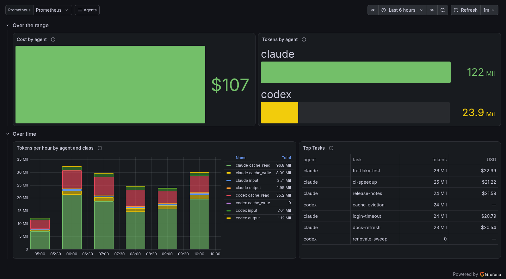

# Thurbox

thurbox v3 is a monorepo: the thurbox interface, Fleet, `runtime-mux` and
`workspace-git`. Fleet runs every session as a Task, so session state now
comes from Fleet ([docs/fleet.md](fleet.md)). This page covers what the
interface itself exports and the agents' own usage. See thurbox's
[observability interface](https://github.com/Thurbeen/thurbox/blob/main/docs/observability.md).

## Send thurbox's telemetry

thurbox has no telemetry setting of its own. The standard `OTEL_*`
variables turn export on, where you start it:

```sh
export OTEL_EXPORTER_OTLP_ENDPOINT=http://localhost:4318
export OTEL_LOGS_EXPORTER=otlp   # optional: the interface's warnings
thurbox
```

- thurbox speaks OTLP over HTTP with protobuf only, and has no TLS client.
- The `fleet` commands thurbox runs inherit the variables and join its
  traces through `TRACEPARENT`.
- Log export is opt-in: an endpoint alone exports traces only, because a
  log line can name paths, sessions and machines.

## Signals

| Signal | What | Where |
| --- | --- | --- |
| Span | `fleet COMMAND` (client), with `fleet.command`, around each fleet command the interface runs | Tempo |
| Log | The interface's own `WARN` and `ERROR` lines | Loki |

The resource is `service.name=thurbox`, `service.version` and
`thurbox.instance` (the multiplexer socket, which tells a sandbox from the
real instance). thurbox exports no metrics, and `thurbox-cli` exports
nothing. The names are in [catalog/thurbox.json](../catalog/thurbox.json).

## Dashboards

| Dashboard | Shows |
| --- | --- |
| **Thurbox interface** | Fleet commands per second and their p50/p95 from spans, the slowest commands, and the interface's warnings. |
| **Agent usage** | Tokens and cost of the agents Fleet launches, by Task, on one scale for every agent. |

## Agent usage



Fleet adds `service.name=<harness>`, `fleet.task` and `fleet.uid` to the
resource of every agent it launches with telemetry. The panels group the
agents' own metrics by the `fleet_task` label, so Prometheus must promote
`fleet.task` and `fleet.uid`, as
[`quickstart/prometheus.yml`](../quickstart/prometheus.yml) does. The agent
comes from the metric itself: Claude Code's and Codex's metrics have
different names.

Each agent's own token types map onto four classes (`TOKEN_CLASSES` in
[tools/dashboards.py](../tools/dashboards.py)):

| Class | Claude Code `type` | Codex `token_type` |
| --- | --- | --- |
| `input` (uncached) | `input` | `input` − `cached_input` |
| `cache_read` | `cacheRead` | `cached_input` |
| `cache_write` | `cacheCreation` | `cache_write_input` |
| `output` | `output` | `output` (includes `reasoning_output`) |

Claude Code's types are disjoint (its documentation). Codex's `total` is
`input` + `output`, so its `input` includes the cached input. The smoke test
checks that the four Codex classes add up to its `total`.

- **Cost** comes from `claude_code.cost.usage` only. No panel estimates a
  cost from a price list.
- The agents export deltas. The collector's `deltatocumulative` processor
  sends a cumulative point only when a delta arrives, so a series has
  samples only in the minutes something happened, and `increase()` misses
  those counts. The panels take the last value in a window minus the last
  value before it instead (`grew()` in
  [tools/dashboards.py](../tools/dashboards.py)).
- The queries are inline rather than recording rules: a rule records only
  from the moment Prometheus loads it, so a new install would show no
  history.
- Metric names come from [catalog/claude-code.json](../catalog/claude-code.json)
  (Claude Code's monitoring documentation) and
  [catalog/codex.json](../catalog/codex.json) (Codex `rust-v0.166.0` source).

## What thurbox v3 no longer exports

thurbox v3 dropped its automations, and with them the `automation tick`
that exported thurbox's session metrics and session event logs. These are
gone, and so are the dashboards and alerts built on them:

- the metrics `thurbox.sessions`, `thurbox.session.transitions`,
  `thurbox.session.lifecycle`, `thurbox.session.exits`,
  `thurbox.turn.duration`, `thurbox.blocked.duration` and
  `thurbox.session.lifetime`;
- the `thurbox.session.*` log events;
- the `thurbox.agent`, `thurbox.session.id` and `thurbox.session.name`
  attributes on each agent's resource, replaced by Fleet's `fleet.task` and
  `fleet.uid`;
- the **Thurbox sessions** and **Thurbox session events** dashboards, and
  the `ThurboxSessionsLost`, `ThurboxLaunchFailed`,
  `ThurboxHostUnreachable` and `ThurboxWaitingOnHuman` alerts. Fleet's
  `fleet.sessions` gauge and the `FleetSessionsLost` alert cover lost
  sessions.

Turn durations and time blocked on a human have no v3 signal.
